# Relatório — Trabalho T1 de Sistemas de Recomendação

- **Disciplina:** Sistemas de Recomendação, Escola Politécnica, PUCRS
- **Professor:** Rafael Scopel, PhD
- **Integrantes:** a definir

> Registro vivo do trabalho: descreve sempre o estado atual. Mudanças no que já foi documentado ficam em [Histórico de alterações](#histórico-de-alterações).

## Sumário

1. [Organização do projeto](#1-organização-do-projeto)
2. [Dados](#2-dados)
3. [Preparação](#3-preparação)
4. [Modelo](#4-modelo)
5. [Avaliação final](#5-avaliação-final)
6. [Interface](#6-interface)
7. [Apresentação](#7-apresentação)
8. [Entrega](#8-entrega)
9. [Histórico de alterações](#histórico-de-alterações)

## 1. Organização do projeto

A pasta do projeto contém o enunciado, o planejamento e os dois arquivos de dados brutos (`meta-Wyoming.json` e `review-Wyoming.json`), que nunca são alterados.

**Estrutura criada:**

| Pasta | Conteúdo |
|---|---|
| `src/` | Código reutilizável, importado pelos notebooks e pela interface |
| `testes/` | Testes do código de `src/` |
| `data/processed/` | Dados tratados |
| `modelos/` | Configuração e modelos gravados |
| `figuras/` | Figuras geradas pelos notebooks e telas da interface |

**Ambiente:** Windows 11 e Python 3.14.7.

| Biblioteca | Versão |
|---|---|
| pandas | 3.0.3 |
| numpy | 2.4.6 |
| scipy | 1.18.1 |
| scikit-learn | 1.9.1 |
| matplotlib | 3.11.1 |
| seaborn | 0.13.2 |
| pyarrow | 24.0.0 |
| joblib | 1.6.0 |
| streamlit | 1.58.0 |
| altair | 6.2.1 |
| playwright | 1.63.0 |
| python-pptx | 1.0.2 |
| nbformat | 5.11.1 |
| nbconvert | 7.17.2 |
| ipykernel | 7.4.0 |
| pytest | 9.2.0 |

Todas já estavam instaladas. Um notebook de teste importou as bibliotecas e foi executado com sucesso pelo nbconvert, no kernel `python3`.

**Publicação da base no Moodle:** feita.

## 2. Dados

Código em `src/dados.py`, testes em `testes/test_dados.py` e execução em `01_dados.ipynb`.

### 2.1 Leitura

A base é a Google Local Data 2021 (McAuley Lab, UCSD), estado de Wyoming, em dois arquivos com um JSON por linha, unidos pelo campo `gmap_id`.

- **Metadados:** todos os campos são lidos, sem tratamento.
- **Avaliações:** lidas linha a linha, mantendo só os locais selecionados, o que equivale a um *inner join*. Ficam `user_id`, `gmap_id`, `rating`, `time` e `text`; `pics` e `resp` viram os indicadores `tem_foto` e `tem_resposta`. O nome de quem avaliou não é carregado.

| Arquivo bruto | Medida | Valor |
|---|---|---|
| Metadados | Linhas | 12.088 |
| Metadados | `gmap_id` distintos | 12.016 |
| Metadados | Sem categoria | 88 |
| Metadados | Sem `state` (nulo ou chave ausente) | 4.623 |
| Avaliações | Linhas | 1.141.421 |
| Avaliações | De locais fora dos metadados | 0 |

Esses valores descrevem os arquivos brutos, antes do recorte e da limpeza.

### 2.2 Recorte pela categoria principal

A **categoria principal** é a primeira da lista que não seja `Caterer`. O local entra se ela for de alimentação, isto é, se casar com o padrão de palavras e não estiver na lista de exclusão. Uma categoria secundária de comida não basta: é isso que deixa de fora hotéis, postos e mercados que têm restaurante ou lanchonete.

| Etapa | Locais | Avaliações |
|---|---:|---:|
| Arquivo inteiro | 12.016 | 1.141.421 |
| Pela regra | 1.855 | 431.165 |
| Inclusão manual | 8 | 2.753 |
| **Recorte** | **1.863** | **433.918** |

As contagens são anteriores à limpeza. Dentro do recorte, nenhuma avaliação está sem `rating` ou `user_id`, 177.319 estão sem texto, 11.092 têm foto e 39.229 têm resposta do local.

**O que ficou de fora:** 151 locais com alguma categoria de comida, somando 31.412 avaliações. Os maiores grupos são hotéis (12.488 avaliações), truck stops (3.958) e mercados (1.795). O local mais avaliado desse grupo é o Little America Hotel - Wyoming, com 5.928 avaliações.

**Inclusão manual:** só entram locais cuja atividade principal é servir comida ou bebida, confirmada nos comentários, e que tenham categoria de comida ou sejam Dinner theater.

| Local | Categoria principal | Avaliações |
|---|---|---:|
| Bar J Chuckwagon Suppers | Dinner theater | 1.066 |
| The Outlaw Saloon | Concert hall | 678 |
| Yellowstone Garage | Event venue | 498 |
| The Cody Cattle Company | Dinner theater | 373 |
| Bar J Chuckwagon | Dinner theater | 52 |
| Pretzelmaker (Cheyenne) | Pretzel store | 44 |
| Sunset House Restaurant | Banquet hall | 26 |
| Pretzelmaker (Casper) | Pretzel store | 16 |

**Examinados e mantidos fora:**

- Alf's Pub, Saddle Lite Saloon, Pizza Ranch FunZone Arcade e Black Gold Grille parecem servir comida ou bebida, mas suas categorias descrevem outro negócio (loja de bebidas, salão de beleza, fliperama e espaço de eventos). Como o conteúdo vem das categorias, o vetor desses locais seria enganoso.
- Galloway's Pub & Bowling alley e Wyoming Downs OTB têm bar, mas a atividade principal é boliche e apostas.

**Limitação:** a regra também aceita alguns locais pequenos que não são restaurantes típicos, como cafeterias de escola e uma loja classificada como Food court. Eles têm poucas avaliações e continuam no recorte, para manter a regra simples.

### 2.3 Limpeza

Os arquivos brutos não são alterados. O resultado está em `data/processed/avaliacoes.parquet` (429.622 linhas, 10 colunas) e `data/processed/locais.parquet` (1.863 linhas, 19 colunas). Duas execuções seguidas geraram arquivos idênticos.

**Funil dos locais:**

| Etapa | Restam | Removidas |
|---|---:|---:|
| Linhas de metadados | 12.088 | |
| `gmap_id` repetido (cópias idênticas) | 12.016 | 72 |
| Sem categoria | 11.931 | 85 |
| Com categoria, fora do recorte | 1.863 | 10.068 |
| Sem avaliação depois da limpeza | 1.863 | 0 |

**Funil das avaliações:**

| Etapa | Restam | Removidas |
|---|---:|---:|
| Avaliações do recorte | 433.918 | |
| Sem nota ou sem usuário | 433.918 | 0 |
| Duplicatas exatas | 429.622 | 4.296 |
| Mesmo usuário e local, fica a mais recente | 429.622 | 0 |

**Decisões e verificações nas avaliações:**

| Item | Regra | Resultado |
|---|---|---|
| Notas | Inteiros de 1 a 5; outro valor interrompe a limpeza | Todas válidas |
| Datas | `time` vira `data`, `ano` e `mes` | De 27/03/2008 a 04/09/2021 |
| Texto ausente | Mantido, com o indicador `tem_texto` | 177.267 (41,3%) |
| Tradução automática | Mantida | 3.290 |
| Rajadas (5 ou mais avaliações do usuário no mesmo minuto) | Mantidas | 5.832 avaliações (1,4%) em 993 rajadas |

**Rajadas:** 209 rajadas (21,0%) têm nota constante, somando 1.199 avaliações. Entre usuários com 5 ou mais avaliações fora de rajada, a nota constante aparece em 11,7%. Mesmo assim, todas continuam: só 5 rajadas repetem texto e há menos notas 5 nelas (46,7%) que fora delas (55,8%), o que não sugere avaliações forjadas.

**Decisões e verificações nos locais:**

| Item | Regra | Resultado |
|---|---|---|
| Cidade e CEP | Extraídos do final do endereço | 115 cidades; 7 locais sem cidade e 6 sem CEP |
| Coordenadas | Fora de lat 40,5 a 45,5 e lon −111,6 a −103,5: anular | Nenhuma anulada |
| Preço | `preco_nivel` conta `$` ou `₩`, artefato da coleta | 16 com `₩`; 691 sem preço |
| Fechados | `fechado_perm` e `fechado_temp`, só pelo texto de `state`; as avaliações continuam, mas o local não é recomendado | 205 permanentes e 33 temporários |
| Colunas | Saem `url` e `hours`; `avg_rating` e `num_of_reviews` ganham o sufixo `_google` | |
| Consistência | Correlação entre `avg_rating_google` e a média na base; só conferência, pois inclui o futuro e não é *feature* | 0,991 |
| Junção | Toda avaliação tem local nos metadados e todo local tem avaliação | Confirmado |

Dos 7 locais sem cidade, 6 não têm endereço e um traz só o CEP. Todos têm coordenada.

### 2.4 Descrição da base

Base limpa, no período inteiro. Só esta descrição usa o período inteiro; as análises que orientam decisões olham apenas os dados anteriores ao corte de teste. O estilo dos gráficos está em `src/graficos.py`.

| Medida | Valor |
|---|---:|
| Avaliações | 429.622 |
| Usuários | 175.278 |
| Locais | 1.863 |
| Cidades | 115 |
| Período | 27/03/2008 a 04/09/2021 |
| Nota média | 4,15 |
| Desvio-padrão da nota | 1,21 |
| Avaliações por usuário (média) | 2,45 |
| Avaliações por local (média) | 230,6 |
| Esparsidade | 99,868% |

Quase toda combinação de usuário e local está vazia, o que limita qualquer técnica que dependa de histórico em comum.

**Notas**

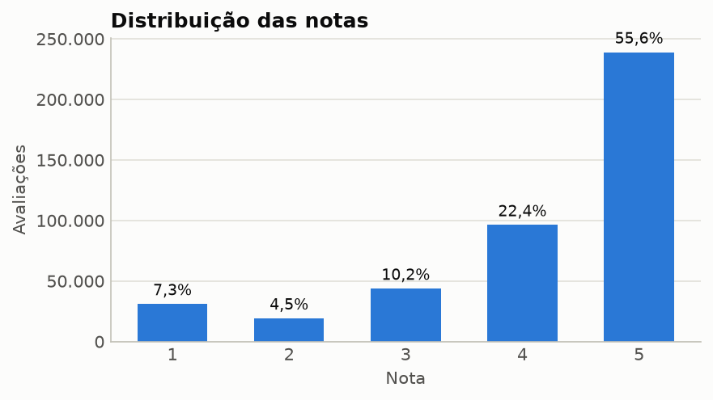

A distribuição é assimétrica: 78,1% das avaliações têm nota 4 ou 5, e a nota 5 sozinha tem 55,6%. Notas de 1 a 3 são o sinal mais raro, o que apoia considerar relevante a nota 4 ou maior.

**Atividade dos usuários**

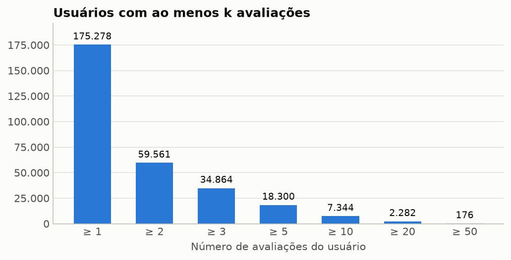

| Com ao menos k avaliações | Usuários | % dos usuários | % das avaliações |
|---:|---:|---:|---:|
| 1 | 175.278 | 100,0% | 100,0% |
| 2 | 59.561 | 34,0% | 73,1% |
| 3 | 34.864 | 19,9% | 61,6% |
| 5 | 18.300 | 10,4% | 48,6% |
| 10 | 7.344 | 4,2% | 32,3% |
| 20 | 2.282 | 1,3% | 16,6% |
| 50 | 176 | 0,1% | 2,7% |

Dos usuários, 66,0% têm uma única avaliação, e o mais ativo tem 136. A maioria das pessoas tem pouquíssimo histórico, o que torna importante o cenário de usuário novo.

**Popularidade**

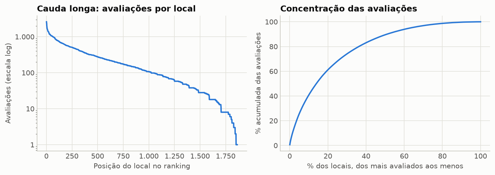

A atenção é concentrada, mas sem domínio extremo: o índice de Gini é 0,587, os 20% de locais mais avaliados têm 61,2% das avaliações e os 19 maiores (1%) têm 7,6%. A mediana é de 123 avaliações por local, contra média de 230,6. O mais avaliado é o Texas Roadhouse de Cheyenne, com 2.598.

**Nota média por usuário e por local**

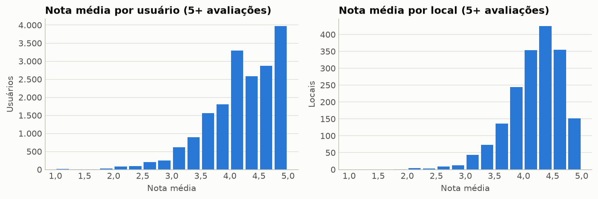

Entre os 18.300 usuários e os 1.811 locais com ao menos 5 avaliações, as médias são parecidas (4,20 e 4,19). Os usuários variam mais (desvio-padrão de 0,61, contra 0,47) e formam um pico perto da média 5. Os locais também variam, o que abre espaço para usar a qualidade do local como sinal.

**Categorias**

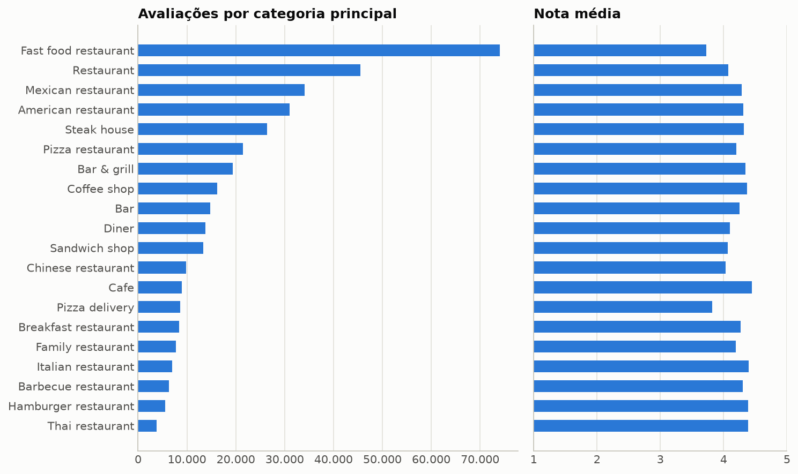

As 20 maiores das 98 categorias principais têm 87,6% das avaliações. Fast food é a mais avaliada (74.061) e tem a menor nota entre elas (3,72), seguida de Pizza delivery (3,82); Cafe tem a maior (4,45). As categorias estão no idioma original da base.

**Cidades e mapa**

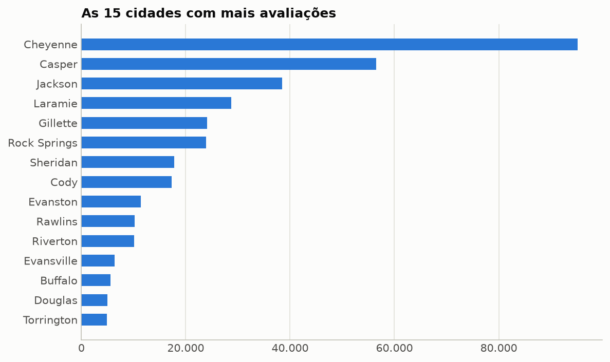

As 15 maiores das 115 cidades têm 82,7% das avaliações, com Cheyenne (95.091), Casper (56.496) e Jackson (38.473) à frente. Evansville, vizinha de Casper, aparece com 6.383: locais muito próximos podem estar em cidades com nomes diferentes, um dos motivos para comparar cidade e distância na Fase 3.

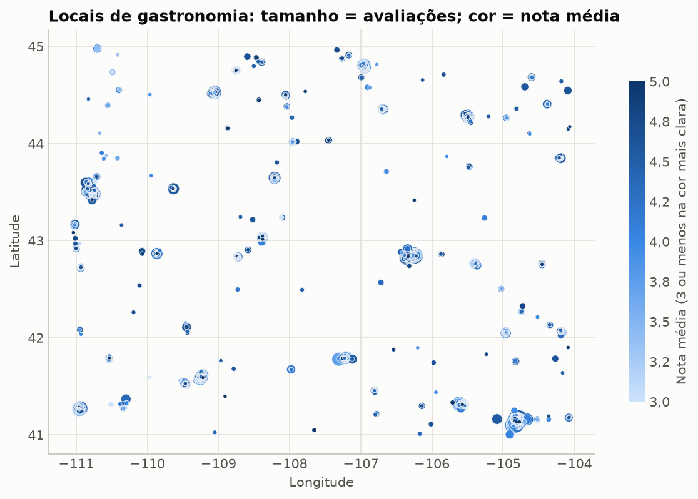

Os locais formam aglomerados isolados nas cidades, com grandes áreas vazias entre eles. Isso sugere que a localização deve pesar na recomendação, hipótese medida na etapa seguinte. A cor não mostra uma região com notas sistematicamente melhores.

**Tempo**

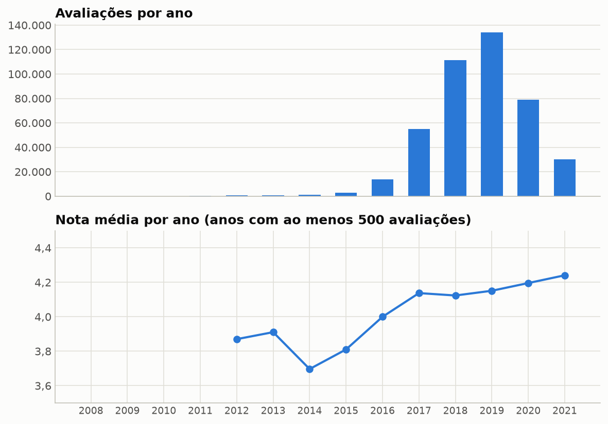

2018 e 2019 têm 57,1% das avaliações. A nota média sobe de 3,70 em 2014 para 4,24 em 2021. Dois eventos viram limitações do trabalho:

- **Pandemia:** queda de 9.357 avaliações em fevereiro de 2020 para 906 em abril, com volta a 6.640 em junho.
- **Fim da coleta:** de 7.215 em abril de 2021 para 709 em junho e só 6 em setembro.

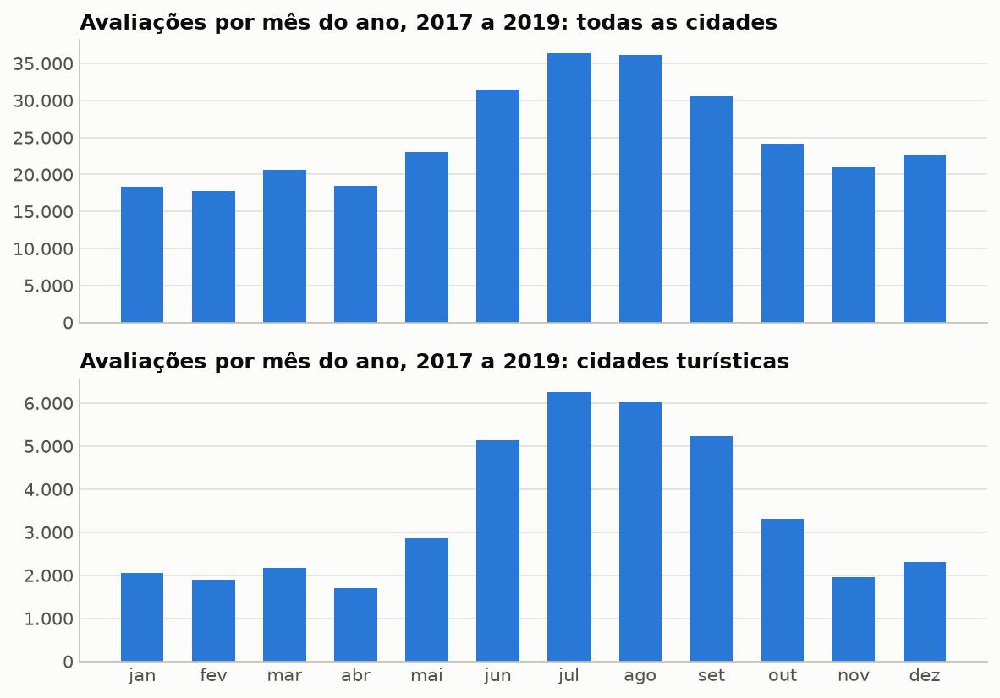

O gráfico usa 2017 a 2019, anos completos e sem pandemia, porque no período inteiro a pandemia e o fim da coleta distorcem os meses.

| Julho em relação a fevereiro | 2017 a 2019 | Período inteiro |
|---|---:|---:|
| Todas as cidades | 2,05 | 1,45 |
| Cidades turísticas (14,2% da base) | 3,29 | 2,34 |

Essa diferença entre estações é o motivo de a validação cobrir um ano completo.

**Preço e atributos**

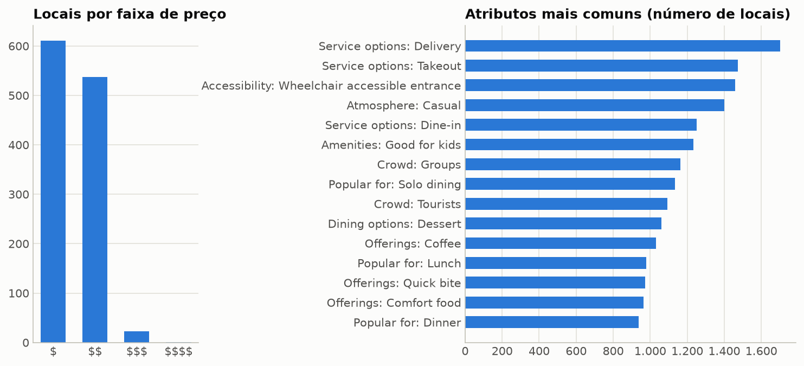

Dos locais, 37,1% não têm preço, e quase todos os demais estão nas faixas \$ e \$\$. Quase todos (99,5%) têm atributos em `MISC`, com 136 valores distintos. Entre os 15 mais comuns, 10 vêm de grupos que derivam do comportamento dos clientes (Atmosphere, Crowd, Popular for, Dining options, Offerings), viés examinado antes de definir o vetor de conteúdo.

**Texto**

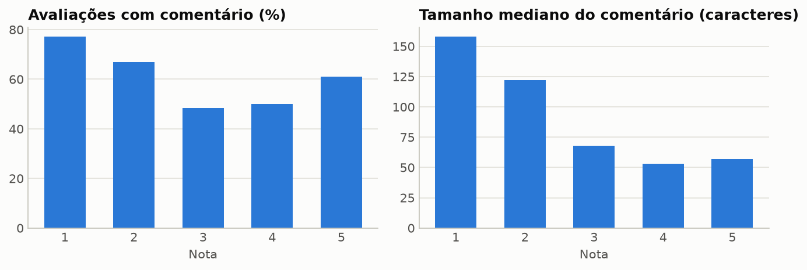

Das avaliações, 58,7% têm comentário. Quem dá nota 1 comenta mais (77,2%, contra 48,5% na nota 3) e escreve mais (mediana de 158 caracteres, contra 53 na nota 4). O texto não entra no modelo, porque um local recém-cadastrado não teria comentários.

### 2.5 Análises para as decisões

Estas análises usam só as avaliações anteriores ao corte de teste, em 31/03/2020 (quantil 80% das datas): 343.697 avaliações, 140.895 usuários e 1.760 locais. Os metadados são uma foto de 2021. Os cálculos estão em `src/analises.py`.

| Análise | Resultado | Decisão que apoia |
|---|---|---|
| k-core | k = 5: 14.871 usuários e 48,3% das avaliações; k = 20: 875 usuários e 7,6% | Técnicas colaborativas puras atendem poucos usuários |
| Sobreposição no 5-core | 20º vizinho com 4 locais em comum (usuários) e 9 usuários em comum (locais) | Vizinhos por usuário são fracos; vizinhos por item ficam como referência |
| Notas constantes | 20,1% dos usuários com 3 ou mais avaliações; 11,1% dos com 5 ou mais | Centro 3 no perfil |
| Variância da nota | Local: 11,5%. Local + usuário, com 5 ou mais avaliações: 36,6% bruto e 29,6% ajustado | Pouco espaço para personalização |
| Estabilidade do escore | Spearman de 0,833 entre os períodos, em 1.279 locais | Usar o escore calculado no treino |
| Nota × popularidade | Spearman de −0,128 | Dois escores separados |
| Conversão × consumo | 77,6% com nota 4 ou 5; 54,2% com nota 5 | Critério duplo: conversão e AUC de gosto |
| Coerência de conteúdo | Mesmo usuário × sorteados: Jaccard de 0,0963 × 0,0851. Gostou × gostou contra não gostou × gostou: 0,0878 × 0,0964 | Categorias não indicam o gosto; o modelo precisa de mais que elas |
| Localidade | Mediana de 75,0% na cidade principal; 24,1% das avaliações em cidade nova | Componente de local, sem filtro rígido |
| Distância | Mediana de 1,3 km; 77,9% a até 10 km; P90 de 144,9 km | Testar também τ = 10 km |
| Viés dos metadados | Preço ausente em 90,3% dos locais sem avaliação e em 5,0% dos mais populares; atributos × popularidade: 0,567 | Preço fora do vetor; revisão dos atributos |
| Usuários e locais novos | 51,1% a 57,4% das avaliações de usuários novos; 1,8% a 2,7% em locais novos | Cenário 2 é o mais comum; cenário 3 é mensurável |
| Referências de nota | RMSE de 1,1951 (média global), 1,1425 (média do local) e 1,1253 (com vieses) | Referências da previsão de nota |

A diferença entre as médias de Jaccard e as reduções de MSE têm intervalo de confiança de 95% que não inclui zero. Na variância, o valor bruto de local + usuário considerando todos os usuários (64,6%) é inflado por quem tem uma única avaliação; ajustado, cai para 39,5%.

**Distância até o local já avaliado mais próximo**

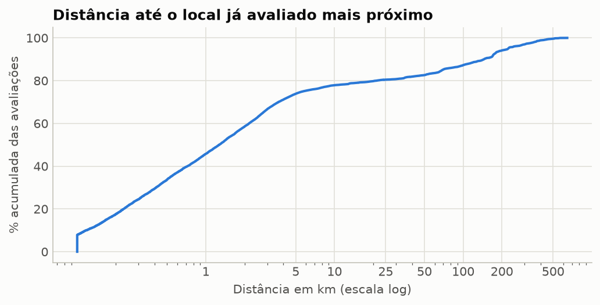

As pessoas ficam na cidade ou viajam para longe: a curva sobe até cerca de 10 km, quase para até 50 km e depois acompanha as viagens.

**Viés dos metadados**

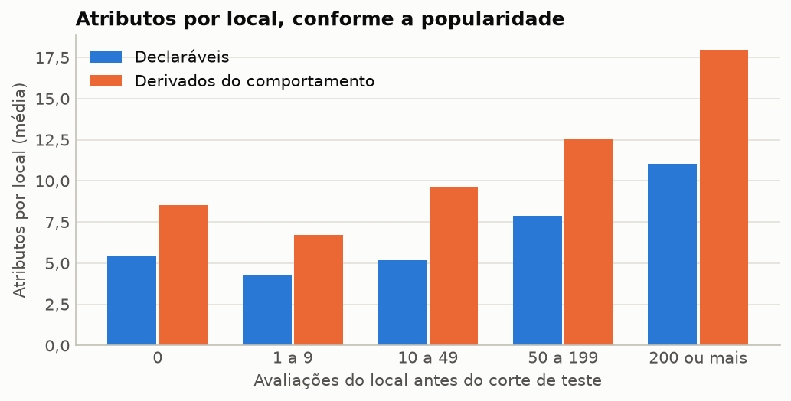

Retirar os grupos derivados não elimina o viés: os atributos declaráveis têm correlação até maior com a popularidade (0,596) que os derivados (0,492). Um local sem avaliações tem em média 5,5 atributos declaráveis, contra 11,0 dos mais populares. O grupo Planning inclui ainda valores que dependem do comportamento dos clientes, como Usually a wait e Quick visit. A classificação continua válida pelo critério de cadastro, e o efeito dos atributos será medido na Fase 3.

| Grupo de `MISC` | Classe | Locais | Spearman com a popularidade |
|---|---|---:|---:|
| Service options | declarável | 1.828 | 0,527 |
| Accessibility | declarável | 1.512 | 0,551 |
| Amenities | declarável | 1.435 | 0,455 |
| Payments | declarável | 770 | 0,310 |
| Planning | declarável | 459 | 0,231 |
| From the business | declarável | 81 | −0,004 |
| Popular for | derivado | 1.183 | 0,492 |
| Highlights | derivado | 1.160 | 0,218 |
| Crowd | derivado | 1.422 | 0,427 |
| Atmosphere | derivado | 1.419 | 0,266 |
| Offerings | derivado | 1.546 | 0,396 |
| Dining options | derivado | 1.246 | 0,426 |
| Health & safety | temporário | 627 | 0,376 |
| Health and safety | temporário | 13 | 0,094 |

**Conclusão sobre a técnica**

| Técnica | A favor | Contra | Cenário 2 | Cenário 3 |
|---|---|---|---|---|
| **Conteúdo e escores de produto (escolhida)** | Escore estável e local explica 11,5% da nota | Categorias não indicam gosto; atributos carregam viés de popularidade | Atende | Atende |
| Vizinhos próximos | Vizinhos por item têm suporte razoável | Por usuário, só 4 locais em comum, mesmo no 5-core | Não atende | Não atende |
| Bases de conhecimento | Não exige histórico | Não há regras de domínio prontas; usaria pouco as notas | Atende | Atende, sem personalização |
| Redes e grafos | Usa caminhos indiretos | Usuários com uma só avaliação ficam na borda do grafo | Não atende sem arestas | Não atende sem arestas |

As colunas "a favor" e "contra" vêm das análises; o que cada técnica atende nos cenários 2 e 3 é um argumento sobre o funcionamento da técnica, medido só na Fase 3. A técnica escolhida continua de pé, por ser a única que atende sozinha os três cenários usando as notas dos usuários. O limite é que o sinal de gosto vem da qualidade do local, com pouco espaço para personalização.

## 3. Preparação

Código em `src/features.py`, testes em `testes/test_features.py` e execução em `02_preparacao.ipynb`.

### 3.1 Representação de conteúdo

Só entra no vetor o que um local recém-cadastrado poderia informar e que não deriva do comportamento futuro.

| Bloco | Origem | Formato do token | Peso inicial |
|---|---|---|---|
| Categorias | Todas em `category`, normalizadas | `cat=pizza_restaurant` | 1 |
| Atributos declaráveis | `MISC`, grupos Service options, Accessibility, Amenities, Payments, Planning, From the business | `misc=service_options:delivery` | 1 |

**Fora do vetor:**

| O que fica fora | Motivo |
|---|---|
| Popular for, Highlights, Crowd, Atmosphere, Offerings, Dining options | Derivam do comportamento dos clientes; um local novo não os teria |
| Health & safety, Health and safety | Temporários da pandemia |
| Preço | Falta em 90,3% dos locais sem avaliação e em 5,0% dos mais populares, o que denuncia a popularidade; continua como filtro na interface |
| Cidade | É um componente próprio do modelo |
| Texto das avaliações | Um local novo não tem |
| `relative_results`, `avg_rating`, `num_of_reviews` | Coletados depois do corte |

**Revisão dos valores declaráveis:** dos 47 valores, 4 foram excluídos e 11 grafias foram unificadas, usando só as avaliações do treino.

| Tratamento | Valores | Motivo |
|---|---|---|
| Excluídos | `Planning: Usually a wait`, `Planning: Quick visit` | Dependem do comportamento dos clientes |
| Excluídos | `Service options: Curbside pickup` (29,0% dos abertos e 1,5% dos fechados), `Service options: No-contact delivery` (9,2% e 0,0%) | Ligados à pandemia; indicam sobretudo que o local continuava aberto na coleta |
| Unificados | 11 grafias da mesma ideia, como `Takeaway` em `Takeout` e `Toilets` em `Restroom` | Fragmentavam o vocabulário |

**Vetorização:** um TF-IDF por bloco (`sublinear_tf`, normalização L2, `min_df = 2`), ponderação por bloco, concatenação e normalização L2 final, de modo que o produto escalar seja o cosseno. Tokens desconhecidos são ignorados, o que permite vetorizar um local novo. O vetorizador é sempre ajustado só com os locais do treino correspondente, e todos os locais são transformados.

**Conferência:** ajustado com os 1.647 locais do treino, o vetor tem 167 tokens (136 de categorias e 31 de atributos) para os 1.863 locais. Todas as normas valem 1, exceto a do único local com vetor vazio (Gillette Cheese House), cuja categoria `Food` não está no vocabulário do treino.

**Limitações:**

- Os atributos declaráveis também crescem com a popularidade (Spearman de 0,596), então parte desse viés continua no vetor; o efeito é medido na Fase 3.
- Os metadados são uma foto de 2021 e também denunciam quem continuava aberto: `Takeout` aparece em 85,4% dos abertos e 27,8% dos fechados, e `Dine-in` em 72,3% e 25,9%. Esses valores continuam, por serem declaráveis e não específicos da pandemia. Como locais fechados não são recomendados, o efeito atinge sobretudo os perfis de quem os avaliou.

### 3.2 Divisão temporal

A divisão respeita o tempo: o modelo só aprende com o passado e é medido no futuro. O código está em `src/divisao.py`.

- **`corte_teste`:** quantil 80% das datas de todas as avaliações, em 31/03/2020. `treino_total` fica antes; `teste`, a partir dele.
- **`corte_validacao`:** exatamente um ano antes, em 31/03/2019, para a validação cobrir todas as estações. `treino` fica antes; `validacao`, entre os dois.
- **Hiperparâmetros:** treinar em `treino` e medir em `validacao`.
- **Modelo final:** reajustar em `treino_total` e medir uma única vez em `teste`.
- **Relevante, ou convertido:** nota 4 ou maior.

| Partição | Início | Fim | Avaliações | % da base | Usuários | Locais | % relevantes |
|---|---|---|---:|---:|---:|---:|---:|
| `treino` | 27/03/2008 | 31/03/2019 | 213.626 | 49,7% | 95.365 | 1.647 | 77,1% |
| `validacao` | 31/03/2019 | 31/03/2020 | 130.071 | 30,3% | 59.543 | 1.602 | 78,5% |
| `treino_total` | 27/03/2008 | 31/03/2020 | 343.697 | 80,0% | 140.895 | 1.760 | 77,6% |
| `teste` | 31/03/2020 | 04/09/2021 | 85.925 | 20,0% | 46.278 | 1.602 | não calculado |

O treino está acima do mínimo de 150 mil avaliações previsto. Do teste só se mostram datas e contagens; nenhuma medida ligada às notas é calculada antes da avaliação final.

**Limitações:**

- **Teste na pandemia:** 86,2% das avaliações do teste (74.081) estão no primeiro ano depois do corte, que começa com só 906 avaliações em abril de 2020. A validação é quase toda anterior à pandemia, exceto por março de 2020, que já cai para 5.075. O comportamento pode ter mudado entre as duas, então a diferença entre validação e teste não mede só a qualidade do modelo. A avaliação final compara o primeiro ano do teste com o período seguinte.
- **Coleta rarefeita no fim:** só 1.129 avaliações (1,3% do teste) são de junho de 2021 em diante, e setembro tem 6. Essa queda vem da coleta, e esse período quase não pesa nos resultados.

### 3.3 Conjuntos por cenário

| Cenário | Treino para escolher | Treino final | Alvo |
|---|---|---|---|
| 1. Usuário antigo | `treino` | `treino_total` | Segmento `antigo` |
| 2. Usuário novo | `treino` | `treino_total` | Segmento `novo` |
| 3. Local novo | `treino` sem `S_val` | `treino_total` sem `S_teste` | Antigos em locais novos |

O cenário 3 tem treino próprio, porque retirar os locais simulados de um treino único prejudicaria os cenários 1 e 2.

**Segmentos**, por avaliação do alvo, conforme o treino correspondente: `antigo` (3 ou mais avaliações), `intermediario` (1 ou 2, só para análise de sensibilidade) e `novo` (nenhuma).

| Segmento | Validação: avaliações | Usuários | % | Teste: avaliações | Usuários | % |
|---|---:|---:|---:|---:|---:|---:|
| Antigo | 33.172 | 6.779 | 25,5% | 22.089 | 6.516 | 25,7% |
| Intermediário | 18.879 | 7.234 | 14,5% | 11.016 | 5.379 | 12,8% |
| Novo | 78.020 | 45.530 | 60,0% | 52.820 | 34.383 | 61,5% |

**Locais novos:**

- **Naturais:** primeira avaliação no período-alvo. São o resultado principal do cenário 3.
- **Simulados:** `S_val` e `S_teste`, com 100 locais cada e disjuntos, sorteados com semente 42 entre locais abertos com ao menos 20 avaliações, olhando só o treino. São reportados à parte, por terem metadados mais ricos e serem mais fáceis.

| Conjunto | Origem | Locais | Abertos | Avaliações no alvo | De usuários antigos | Usuários antigos |
|---|---|---:|---:|---:|---:|---:|
| Validação | Natural | 113 | 106 | 4.603 | 1.357 | 1.047 |
| Validação | Simulado | 100 | 100 | 9.860 | 2.579 | 1.850 |
| Teste | Natural | 103 | 100 | 3.367 | 951 | 830 |
| Teste | Simulado | 100 | 100 | 6.156 | 1.567 | 1.296 |

**Treinos do cenário 3:** retirar `S_val` deixa 196.785 avaliações (16.841 a menos), e retirar `S_teste` deixa 318.092 (25.605 a menos).

**Limitação:** há poucas avaliações de usuários antigos em locais novos reais, então os intervalos de confiança do cenário 3 devem ser mais largos.

**Arquivos em `data/processed/conjuntos/`:** as 4 partições, `treino_c3`, `treino_total_c3`, `locais_novos`, `indice_locais` e `divisao.json`, com os cortes e as contagens. As partições não guardam o texto das avaliações, que não é usado no modelo. Duas execuções seguidas geraram arquivos idênticos.

### 3.4 Conferências

**Conteúdo na prática**

| Bloco | Antes do `min_df` | Depois do `min_df` |
|---|---:|---:|
| Categorias | 226 | 136 |
| Atributos | 31 | 31 |

A matriz tem 1.863 locais e 167 tokens, com 94,0% de esparsidade e mediana de 9 tokens por local. Os menores IDF são atributos muito comuns, como Delivery (1,08), e os maiores são tokens raros, como `cat=pretzel_store` (7,31).

**Vizinhos por conteúdo**

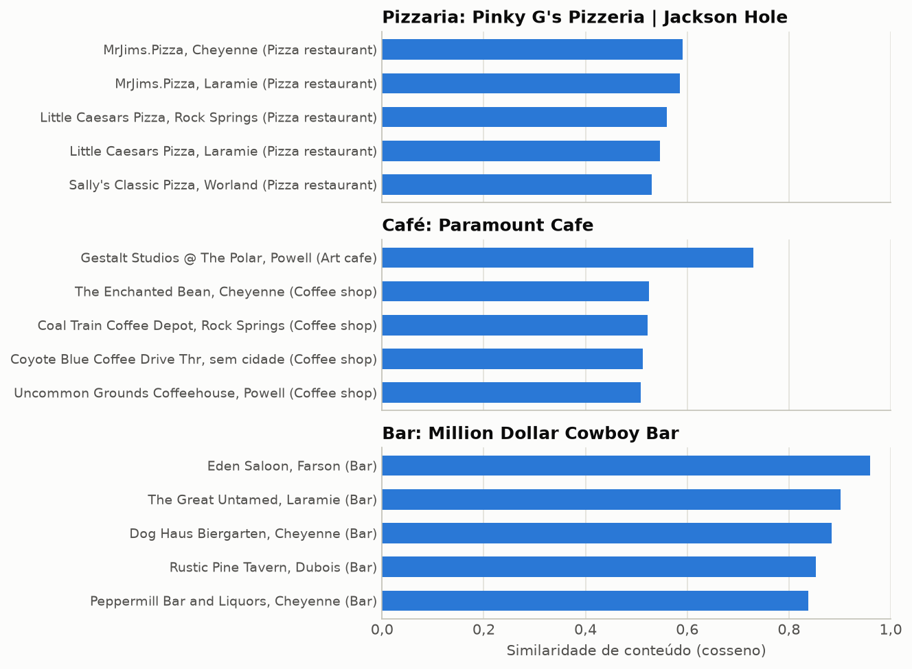

Os vizinhos dos três exemplos são do mesmo tipo.

| Vetor | 5 vizinhos com a mesma categoria principal | 5 vizinhos com alguma categoria em comum |
|---|---:|---:|
| Categorias + atributos | 79,7% | 98,1% |
| Só categorias | 77,9% | 99,4% |
| Sorteados ao acaso | 5,7% | não medido |

Os atributos reduzidos não pioraram a vizinhança. O cosseno mede semelhança de tipo, não de qualidade nem de gosto: o Million Dollar Cowboy Bar fica a 0,959 de um bar de Farson porque os dois têm a categoria Bar e atributos parecidos. Os escores de produto ajudam a compensar essa limitação.

**Divisão temporal**

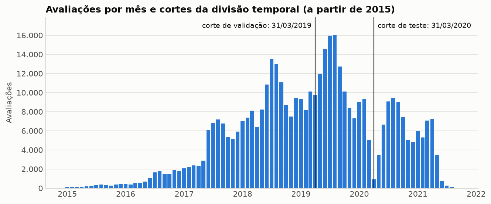

A validação cobre um ano inteiro, incluindo o pico de verão de 2019, e termina na queda de março de 2020. O teste começa no ponto mais baixo da pandemia e se esvazia no fim da coleta.

**Verificações automáticas:** as 17 passaram. Elas conferem datas sem sobreposição, contagens que fecham, `S_val` e `S_teste` fora de seus treinos e disjuntos entre si, 100 locais em cada simulado, ao menos 20 avaliações no treino por simulado, nenhum simulado fechado, usuário novo fora do treino, antigo com 3 ou mais avaliações, local novo natural fora do treino, índice completo, divisão reproduzível e arquivos gravados iguais aos da memória. O teste é apenas gravado, sem nenhuma medida ligada às notas.

## 4. Modelo

Código em `src/metricas.py`, testes em `testes/test_metricas.py` e execução em `03_modelo.ipynb`. Tudo nesta etapa usa só treino e validação.

### 4.1 Métricas e protocolo

Todas as métricas são as vistas em aula. As definições de cobertura, novidade e serendipidade vêm da literatura geral.

| Métrica | Papel | Como é medida |
|---|---|---|
| Taxa de conversão@10 | Principal nos cenários 1 e 2 | Fração da lista que o usuário avaliou com nota 4 ou maior no período |
| Curva ROC: AUC de gosto | Principal nos cenários 1 e 2 | Entre os locais avaliados no período: nota 4 ou maior × nota 3 ou menor. Só usuários com os dois tipos; empate vale meio |
| Taxa de conversão, versão literal | Reportada | Fração da lista que o usuário avaliou, com qualquer nota |
| Curva ROC: AUC de consumo | Principal no cenário 3 | Locais convertidos × demais candidatos |
| Correlação de rankings | Confirmação | Spearman e tau-b de Kendall entre pontuação e nota, por usuário com 3 ou mais avaliações e notas variadas |
| MAE, MSE, RMSE | Só para a nota prevista | Previsão de nota contra a nota real |
| Cobertura do catálogo | Proteção contra listas repetidas | Fração dos candidatos em alguma lista |
| Cobertura dos espaços de usuários e de itens | Decisiva nos cenários 2 e 3 | Usuários com ao menos 10 locais pontuáveis; locais pontuáveis para ao menos 10 usuários |
| Novidade | Acompanhamento | Média de `−log2(fração das avaliações do local no treino)`; local sem avaliação conta como tendo uma |
| Serendipidade | Acompanhamento | Fração da lista que converte e não está na lista óbvia |
| Diversidade | Acompanhamento | Média de `1 − cosseno` entre os pares da lista |
| Intervalos de confiança | Em todas as comparações | 95%, *bootstrap* por usuário, semente 42, pareado nas diferenças; se inclui zero, é empate |

**Protocolo único**, com os mesmos usuários, candidatos e conversões para todo modelo:

- **Candidatos:** locais abertos do treino, ou uma lista informada (cenário 3).
- **Usuários:** do segmento, com ao menos uma conversão entre os candidatos; até 10.000, sorteados se passar disso.
- **Exclusão:** locais já avaliados no treino saem da lista do usuário.
- **Ordenação:** completa, sem amostrar negativos.
- **Empates:** desfeitos por sorteio com semente fixa, para não favorecer a ordem do catálogo.
- **Modelo:** uma função que devolve a matriz usuários × candidatos; `NaN` marca um par que ele não consegue pontuar.

**Conferência nos dados reais:** duas referências simples, na validação, com 6.078 usuários antigos e 1.419 candidatos. Nenhuma decisão vem delas.

| Medida | Aleatória | Popularidade |
|---|---:|---:|
| Conversão@10 | 0,0028 | 0,0204 |
| Consumo@10 | 0,0035 | 0,0229 |
| AUC de gosto | 0,4973 | 0,4858 |
| AUC de consumo | 0,5016 | 0,7394 |
| Spearman | 0,0050 | −0,0294 |
| Tau-b de Kendall | 0,0052 | −0,0272 |
| Novidade | 11,6097 | 7,8146 |
| Diversidade | 0,7616 | 0,6754 |
| Cobertura do catálogo | 100,0% | 1,3% |

A ordenação aleatória dá o que se espera do acaso: conversão@10 de 0,0028, contra 0,0029 calculados, e AUCs perto de 0,5. A popularidade converte mais (diferença de 0,0175, IC 95% de 0,0162 a 0,0188), mas empata com a aleatória na AUC de gosto (diferença de −0,0115, IC 95% de −0,0298 a 0,0071). Isso mostra por que a conversão sozinha não basta: ela mede aonde a pessoa vai, não se ela gostou.

**Limitação:** a AUC de gosto vale só para 2.397 dos 6.078 usuários, os que têm notas boas e ruins no período.

### 4.2 Componentes do modelo

Código em `src/recomendador.py` e testes em `testes/test_recomendador.py`. A conferência abaixo usa só o treino.

| Componente | Fórmula | Conferência no treino |
|---|---|---|
| Escore de qualidade | `escore_i = (v_i·R_i + m·C) / (v_i + m)`, normalizado por `(escore − 1) / 4` | `C` = 4,116; `m` = 75 (mediana das avaliações por local) |
| Escore da cidade | Mesma fórmula, com prior na média da cidade, também suavizada | Priores de 3,546 a 4,554 |
| Perfil do usuário | `p_u = Σ w_ui·x_i`, normalizado em L2, com `w_ui = nota − 3`; só notas neutras: média simples | 95.365 perfis; 5.384 só com notas neutras; 5 com vetor nulo |
| Popularidade | `pop_i = log(1 + v_i) / log(1 + máx v)`; local novo: mediana da cidade ou do catálogo | Mediana de 0,620 nos locais sem avaliação e 0,600 nos avaliados |
| Local por cidade | Fração das avaliações do usuário na cidade do candidato | Média de 0,069 |
| Local por distância | Média de `exp(−km/τ)` nos locais avaliados pelo usuário | Média de 0,072 com τ = 25 km |
| Previsão de nota | Escore + viés regularizado do usuário (`reg = 10`), limitada a [1, 5] | Viés de −1,382 a 0,793; desvio-padrão de 0,151 |

**O que a conferência mostra:**

- **A suavização funciona:** os 62 locais com média 5 têm mediana de 3 avaliações, e nenhum passa de um escore de 4,413. O maior escore entre os abertos é 4,687, do Sweet Melissa (Laramie), com média de 4,788 em 424 avaliações. Os menores são redes de fast food, como Sonic Drive-In e McDonald's, com centenas de avaliações.
- **Local novo não é penalizado:** a popularidade dos locais sem avaliação (mediana de 0,620) fica perto da dos avaliados (0,600).
- **Cidade e distância são muito parecidas:** a correlação é de 0,958 com τ = 25 km, então a comparação da Fase 3 pode terminar em empate.

**Limitação a considerar nos pesos:** os componentes têm espalhamentos muito diferentes entre os locais e usuários. O desvio-padrão é de 0,054 no escore normalizado, 0,095 na similaridade, 0,179 na popularidade e 0,220 no local por cidade. Por isso, um peso maior não significa maior importância: o escore precisa de um peso alto para mudar a ordem tanto quanto o local muda com um peso baixo. Os pesos devem ser lidos pelo efeito nas métricas.

### 4.3 Pontuação e escolha dos hiperparâmetros (cenário 1)

`s(u,i) = α·sim(u,i) + β·escore_i + γ·local_u(i) + δ·pop_i`, com `sim = (cos + 1) / 2`, pesos não negativos e soma 1.

**Critério:** entre as combinações com conversão@10 de pelo menos 95% da melhor, a de maior AUC de gosto, exigindo `α ≥ 0,1`. Em variantes, a configuração atual só muda se a melhora na AUC de gosto não for empate. As grades estão em `modelos/grades/`, e tudo é medido na validação, com 6.078 usuários antigos e 1.419 candidatos.

**Configuração congelada** (`modelos/cenario1.json`):

| Hiperparâmetro | Valor |
|---|---|
| Pesos (conteúdo / escore / local / popularidade) | 0,1 / 0,2 / 0,5 / 0,2 |
| Local | Distância com τ = 200 km |
| `m` do escore | Percentil 25 (m = 26) |
| Centro do perfil | Média do usuário; 3 para quem não varia as notas |
| Blocos do vetor | Categorias + atributos, peso 1 em cada |

| Medida na validação | Valor | IC 95% |
|---|---:|---:|
| Conversão@10 | 0,0739 | 0,0713 a 0,0766 |
| AUC de gosto (2.397 usuários) | 0,5850 | 0,5721 a 0,5981 |
| Consumo@10 | 0,0836 | |
| AUC de consumo | 0,9167 | |
| Spearman | 0,1200 | |
| Tau-b de Kendall | 0,1024 | |
| Novidade | 9,0859 | |
| Diversidade | 0,6916 | |
| Serendipidade | 0,0236 | |
| Cobertura do catálogo | 45,9% | |
| Cobertura dos usuários e dos itens | 100,0% | |

**Local e pesos foram escolhidos em conjunto.** Com pesos fixos, um τ maior achata o local e dá mais força relativa ao escore, um efeito que os pesos também produzem, e o critério continuava preferindo τ maior a cada valor testado. Por isso, a grade de 286 combinações foi rodada para cada versão de local:

| Versão | Aptas | Melhor combinação | Conversão@10 | AUC de gosto | Cobertura |
|---|---:|---|---:|---:|---:|
| Cidade | 2 | 0,1 / 0,1 / 0,6 / 0,2 | 0,0761 | 0,5168 | 51,2% |
| Distância τ = 50 km | 21 | 0,1 / 0,2 / 0,5 / 0,2 | 0,0765 | 0,5594 | 51,4% |
| Distância τ = 100 km | 20 | 0,1 / 0,2 / 0,5 / 0,2 | 0,0770 | 0,5613 | 48,3% |
| **Distância τ = 200 km** | 10 | **0,1 / 0,2 / 0,5 / 0,2** | **0,0759** | **0,5634** | **45,0%** |
| Distância τ = 400 km | 5 | 0,1 / 0,1 / 0,7 / 0,1 | 0,0770 | 0,5539 | 56,6% |
| Distância τ = 800 km | 1 | 0,1 / 0,0 / 0,8 / 0,1 | 0,0755 | 0,4727 | 57,8% |

Valores antes dos refinamentos, com limite de conversão de 0,0754. Contra a melhor combinação com cidade, a conversão empata (−0,0001, IC 95% de −0,0014 a 0,0011) e a AUC de gosto é maior (0,0466, IC 95% de 0,0381 a 0,0556). Os pesos coincidem com os de referência, mas saíram da grade.

**Refinamentos, um por vez:**

| Refinamento | Resultado | Decisão |
|---|---|---|
| `m` no percentil 25 | AUC de gosto +0,0118 (IC 95% de 0,0089 a 0,0149); conversão −0,0011 | Adotado |
| Centro pela média do usuário | AUC de gosto +0,0097 (IC 95% de 0,0049 a 0,0145); conversão −0,0009 | Adotado |
| Atributos com peso 0,5 ou só categorias | Empate nas duas métricas | Categorias + atributos ficam |
| Só atributos | Conversão −0,0017 (IC 95% de −0,0026 a −0,0008) | Descartado |
| Incluir atributos derivados | AUC de gosto +0,0042 (IC 95% de 0,0008 a 0,0076); conversão empata | Seguem fora: ganho pequeno |
| Incluir preço | Empate nas duas métricas | Segue fora |

O refino dos pesos, com 52 combinações em torno da escolhida, não os mudou.

**Fronteira entre conversão e gosto**

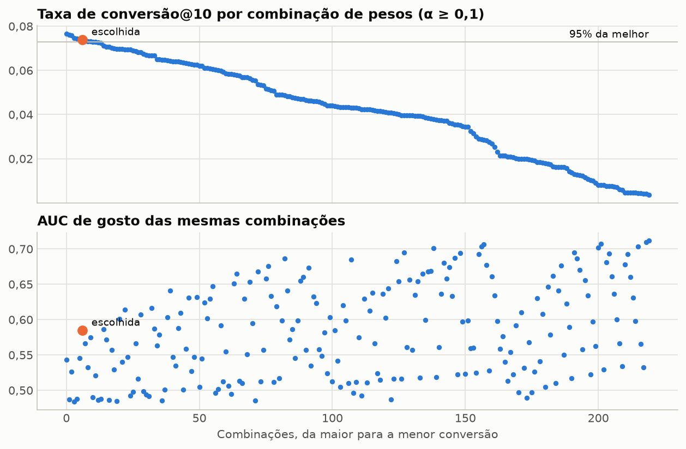

| Limiar | Pesos | Conversão@10 | AUC de gosto | Cobertura | Conversão cedida | Gosto ganho |
|---:|---|---:|---:|---:|---:|---:|
| 100% | 0,1 / 0,1 / 0,6 / 0,2 | 0,0767 | 0,5431 | 50,0% | 0,0% | 0,0000 |
| **95%** | **0,1 / 0,2 / 0,5 / 0,2** | **0,0739** | **0,5850** | **45,9%** | **3,6%** | **0,0418** |
| 90% | 0,1 / 0,3 / 0,4 / 0,2 | 0,0696 | 0,6144 | 40,7% | 9,3% | 0,0713 |
| 80% | 0,1 / 0,4 / 0,3 / 0,2 | 0,0644 | 0,6411 | 32,6% | 16,1% | 0,0980 |
| 70% | 0,1 / 0,5 / 0,3 / 0,1 | 0,0538 | 0,6677 | 35,4% | 29,8% | 0,1246 |

Conversão e gosto competem (correlação de −0,36 na grade final): cada ganho de gosto custa conversão.

**Ablação**

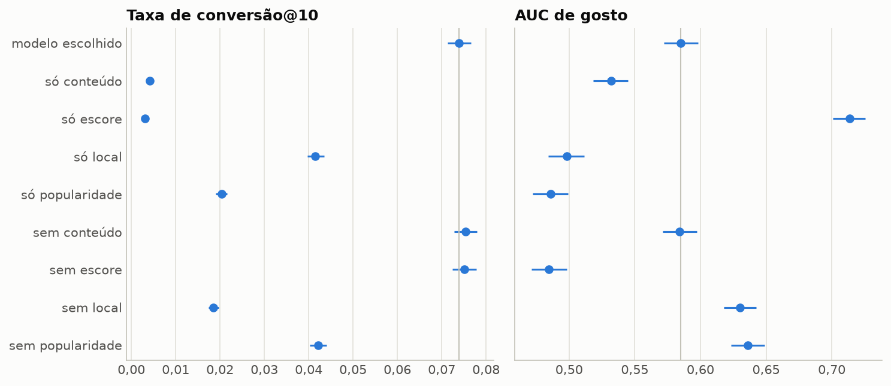

| Caso | Conversão@10 | AUC de gosto | Cobertura |
|---|---:|---:|---:|
| Modelo escolhido | 0,0739 | 0,5850 | 45,9% |
| Só conteúdo | 0,0041 | 0,5321 | 99,4% |
| Só escore | 0,0031 | 0,7136 | 1,0% |
| Só local | 0,0415 | 0,4981 | 95,7% |
| Só popularidade | 0,0204 | 0,4858 | 1,3% |
| Sem conteúdo | 0,0754 | 0,5842 | 40,8% |
| Sem escore | 0,0751 | 0,4847 | 49,0% |
| Sem local | 0,0185 | 0,6300 | 6,6% |
| Sem popularidade | 0,0421 | 0,6358 | 66,5% |

- **A combinação vale mais que as partes:** nenhum componente sozinho passa de 0,0415 de conversão.
- **Local e popularidade respondem pela conversão, e o escore pelo gosto:** sem o escore, a AUC de gosto cai para 0,4847.
- **O conteúdo não melhora as métricas principais no cenário 1:** sem ele, a conversão é até maior (0,0015, IC 95% de 0,0005 a 0,0024) e a AUC de gosto empata (−0,0007, IC 95% de −0,0061 a 0,0046). A contribuição dele aqui é ampliar o catálogo, e `α` fica no mínimo exigido. O melhor com `α = 0` antes dos refinamentos (0 / 0,2 / 0,6 / 0,2) empata na conversão e tem AUC de gosto maior (0,0089, IC 95% de 0,0035 a 0,0144). O papel principal do conteúdo está no cenário 3.

**Sensibilidade:** com limiar de 90% ou 97%, os pesos mudam, como mostra a fronteira. Com usuários de 1 ou mais avaliações, uma amostra de 10.000 escolhe os mesmos pesos (conversão de 0,0598 e AUC de gosto de 0,5783).

**Limitações:**

- A escolha conjunta de local e pesos foi feita antes dos refinamentos de `m` e centro. Com a configuração final e pesos fixos, o critério apontaria τ = 400 km (conversão de 0,0716, AUC de gosto de 0,5913 e cobertura de 39,5%), comparação que tem o mesmo problema descrito acima e não foi seguida.
- "Só categorias" empata com categorias + atributos, e a escolha entre eles é frágil.
- A AUC de gosto vale só para quem tem notas boas e ruins no período.

A usuária decidiu manter o conteúdo com peso de 0,1, mesmo sem ganho nas métricas principais do cenário 1.

### 4.4 Implementação do recomendador

A classe `Recomendador`, em `src/recomendador.py`, recebe pesos, `m`, centro, tipo de local e τ, e reúne as operações:

| Operação | O que faz |
|---|---|
| `ajustar` | Ajusta com as avaliações do treino, os locais, o vetorizador e a matriz |
| `componentes`, `pontuar` | Calculam os componentes e a pontuação, em lote |
| `prever_nota` | Escore do local + viés do usuário, limitada a [1, 5] |
| `explicar` | Local bem avaliado (nota 4 ou maior) mais parecido e os 3 tokens que mais pesam |
| `recomendar` | Lista para usuário com histórico, inclusive com 1 ou 2 avaliações: abertos não avaliados, com componentes, explicação e a cota de 1 local novo (seção 4.6) |
| `recomendar_usuario_novo` | Lista com o que a pessoa informar; tudo é opcional |
| `usuarios_para_local_novo`, `posicao_local_novo` | Usuários indicados para um local novo e a posição dele na lista de um usuário |

O dicionário em `src/traducoes.py` traduz os tokens para português (`misc=service_options:delivery` vira "Entrega"), e tokens sem tradução não aparecem. Os pesos do usuário novo e do local novo são decididos nas seções 4.5 e 4.6, e a classe os usa por padrão.

**Conferência na validação:**

- A classe dá as mesmas pontuações da etapa anterior.
- Os 167 tokens do vetor têm tradução.
- Uma lista com explicações leva 0,13 s.
- Em 100 usuários e 1.000 recomendações, nenhum local fechado ou já avaliado entrou na lista, e 99,0% das explicações têm um local parecido.

**Limitações:**

- **A lista é pouco pessoal:** um usuário de exemplo, de Cheyenne, recebe sobretudo os locais populares e bem avaliados da cidade, como Texas Roadhouse e Chick-fil-A. Isso é coerente com a ablação. Com a cota da seção 4.6, o 10º lugar passa a ser um local novo.
- **A explicação é uma justificativa, não a causa:** "porque você gostou de X" aponta o local mais parecido, mas o que mais pesa na posição é o local e a popularidade. Por isso, a interface deve mostrar também as barras dos componentes.

### 4.5 Cenário 2: usuário novo

**Protocolo:** usuários sem avaliações no treino e com 2 ou mais avaliações na validação. Em ordem de data, a primeira avaliação simula o cadastro e as demais são o alvo. O cadastro informa a cidade do local avaliado e, conforme o método, a categoria principal dele ou o próprio local, como exemplo. Esse local sai da lista e do alvo. Os demais critérios são os do protocolo único (seção 4.1). A função `simular_cadastros`, em `src/divisao.py`, monta os cadastros.

| Etapa | Usuários |
|---|---|
| Novos na validação | 45.530 |
| Com 2 ou mais avaliações | 12.037 |
| No protocolo (sorteados entre os que convertem depois do cadastro) | 10.000 |
| Com AUC de gosto (notas boas e ruins depois do cadastro) | 2.254 |

O alvo tem 28.428 avaliações. Em média, 55,6% delas ficam na cidade do cadastro, e só 18,8% têm a categoria declarada (12,1% entre todos os candidatos). Dos locais de exemplo, 2,3% são locais novos, fora do treino.

**Métodos:** o local declarado é a proximidade ao centro da cidade informada, `exp(−km / τ)` com τ = 200 km, como no cenário 1. Os pesos dos métodos 3 e 4 saíram de uma grade com passo de 0,1, pelo critério do cenário 1, sem exigir conteúdo: escore + popularidade ficou com 0,3 / 0,7, e o método 4, com 0 / 0,2 / 0,5 / 0,3 (conteúdo / escore / local / popularidade). Nos métodos 5 e 6, o conteúdo entra com peso `α`, e os demais pesos do método 4 são multiplicados por `1 − α`. Como filtro, os locais da categoria declarada vêm primeiro e os demais completam a lista.

| Método | Conversão@10 | AUC de gosto | Cobertura do catálogo | Conversão − método 4 (IC 95%) | Gosto − método 4 (IC 95%) |
|---|---|---|---|---|---|
| 1. Popularidade | 0,0129 | 0,4946 | 0,8% | −0,0355 (−0,0369 a −0,0341) | −0,0593 (−0,0749 a −0,0442) |
| 2. Escore | 0,0022 | 0,6905 | 0,8% | −0,0462 (−0,0477 a −0,0447) | 0,1366 (0,1177 a 0,1549) |
| 3. Escore + popularidade | 0,0127 | 0,5560 | 0,8% | −0,0357 (−0,0371 a −0,0343) | empate |
| **4. Local + escore + popularidade** | **0,0484** | **0,5539** | **27,9%** | — | — |
| 5. + categorias, α = 0,05 | 0,0484 | 0,5541 | 31,8% | empate | empate |
| 5. + categorias, α = 0,1 | 0,0478 | 0,5513 | 38,0% | −0,0006 (−0,0011 a −0,0001) | empate |
| 5. + categorias, α = 0,2 | 0,0474 | 0,5461 | 54,0% | −0,0010 (−0,0018 a −0,0003) | −0,0078 (−0,0154 a −0,0005) |
| 5. + categorias como filtro | 0,0239 | 0,5039 | 83,8% | −0,0246 (−0,0261 a −0,0229) | −0,0501 (−0,0633 a −0,0374) |
| 6. + local de exemplo, α = 0,05 | 0,0486 | 0,5524 | 31,6% | empate | empate |
| 6. + local de exemplo, α = 0,1 | 0,0488 | 0,5502 | 38,1% | empate | empate |
| 6. + local de exemplo, α = 0,2 | 0,0488 | 0,5351 | 55,4% | empate | −0,0188 (−0,0275 a −0,0103) |

A cobertura do espaço de usuários é de 100% em todos os métodos, inclusive para quem não informa nada. O notebook traz também consumo, AUC de consumo, novidade, serendipidade e diversidade, que servem de acompanhamento.

**Leitura:**

- **A cidade é o que mais ajuda:** o método 4 converte quase quatro vezes mais que a popularidade global.
- **O escore sozinho tem a maior AUC de gosto e quase não converte:** ordena bem o que a pessoa já escolheu, mas não acerta aonde ela vai.
- **O conteúdo declarado, com peso baixo, empata com o método 4 e amplia o catálogo.** Com peso 0,2, piora o gosto. Isso repete o que se viu no cenário 1.
- **Categorias como filtro derrubam a conversão à metade.** Como só 18,8% do que a pessoa avalia depois tem a categoria declarada, o filtro afasta da lista os locais aonde ela iria de fato. A simulação usa a categoria do primeiro local avaliado, e uma pessoa que escolhe categorias num formulário pode querer de fato só aquelas. Essa diferença é uma limitação da medida.
- **O critério** aponta categorias com α = 0,05, em empate com o método 4 e com o local de exemplo com α = 0,05 ou 0,1.

**Regra de não esvaziar:** em `recomendar_usuario_novo`, preferências e filtros nunca deixam a lista vazia. Os locais das categorias, quando usadas como filtro, vêm primeiro, e os demais completam a lista. O filtro de preço é ignorado se sobrarem menos locais que o pedido. Uma cidade com menos locais que o pedido é ampliada para os mais próximos. Cada caso gera um aviso para a interface.

**Decisão da usuária:** as categorias declaradas entram **com peso de 0,05**, e não como filtro. O peso vale para todo o conteúdo declarado (categorias, atributos e local de exemplo), e os demais são os do método 4 multiplicados por 0,95.

**Congelado para o cenário 2:** pesos 0,05 / 0,19 / 0,475 / 0,285 (conteúdo / escore / local / popularidade), gravados em `modelos/cenario2.json` e usados por padrão na classe. Na validação: **conversão@10 de 0,0484 (IC 95% de 0,0469 a 0,0499) e AUC de gosto de 0,5541 (IC 95% de 0,5384 a 0,5696)**, esta medida em 2.254 usuários.

**Limitação:** com esse peso, a categoria declarada quase não muda a lista. Um usuário de exemplo que informa Cheyenne e restaurante chinês recebe só um restaurante chinês, em 8º, e o resto são os locais populares e bem avaliados da cidade. O que a pessoa declara desempata e amplia o catálogo, sem custar conversão.

### 4.6 Cenário 3: local novo para usuário antigo

O modelo é ajustado no treino do cenário 3, sem os 100 locais simulados da validação, com o vetorizador ajustado nele e a configuração do cenário 1. Um local novo não tem avaliações: o escore é a média do treino (`C` = 4,114) e a popularidade é a mediana da cidade. Os resultados ficam separados por origem: os locais novos **naturais** são o resultado principal, e os **simulados**, uma conferência.

| Origem | Locais abertos | Usuários antigos com conversão | Conversões |
|---|---|---|---|
| Naturais | 106 | 857 | 1.056 |
| Simulados | 100 | 1.553 | 2.038 |

`relative_results` não é usado: foi coletado em 2021, depois do corte, reflete o comportamento dos usuários no Google e não existiria para um local recém-cadastrado.

**Investigação: centro do perfil.** Com o perfil do cenário 1, centrado na média do usuário, o conteúdo piorava a ordenação dos locais novos, e sozinho ficava quase no acaso (AUC de consumo de 0,5107 nos naturais). Esse perfil mede do que a pessoa gosta mais que o normal para ela, e não o tipo de lugar que ela frequenta, que é o que prevê aonde ela vai. Com o perfil centrado em 3, o conteúdo sozinho chega a 0,6351, e somado ao local passa a melhorar a ordenação. **A usuária decidiu usar no cenário 3 o perfil centrado em 3**; o cenário 1 continua com o centrado na média, que lá dá mais AUC de gosto.

**Ordenar locais novos para um usuário** (`α·sim + (1 − α)·local`, naturais):

| Pontuação | AUC de consumo | Conversão@10 | Diferença na AUC de consumo para o só local (IC 95%) |
|---|---|---|---|
| Aleatório | 0,4994 | 0,0119 | −0,4202 (−0,4391 a −0,4007) |
| Só local (α = 0) | 0,9195 | 0,0877 | — |
| α = 0,1 | 0,9292 | 0,0951 | 0,0097 (0,0073 a 0,0122) |
| **α = 0,5** | **0,9314** | **0,0939** | **0,0119 (0,0074 a 0,0163)** |
| α = 0,7 | 0,9235 | 0,0911 | empate |
| Só conteúdo | 0,6351 | 0,0212 | −0,2844 (−0,3044 a −0,2641) |

O critério (conversão de pelo menos 95% da melhor, depois a maior AUC de consumo) escolhe **α = 0,5**, em empate com α de 0,1 a 0,4. A grade do plano ia até 0,3 e foi ampliada para 0,4, 0,5 e 0,7, porque o critério escolhia o fim dela. Nos simulados, α = 0,5 sobe a AUC de consumo em 0,0050 (IC 95% de 0,0017 a 0,0083) e empata na conversão. Só com categorias, a AUC de consumo cai 0,0050 nos naturais e 0,0126 nos simulados, então os atributos ficam no vetor, o que resolve a dúvida da seção 4.3.

**Saída A, local → usuários:** para cada local novo, os usuários antigos que o avaliaram bem ficam acima dos demais com AUC média de 0,9176 nos naturais (85 locais), contra 0,9102 só com o local (+0,0074, IC 95% de 0,0025 a 0,0123) e 0,47 do aleatório. Nos simulados, 0,8811 contra 0,8740, em empate. O cadastro manual, com categorias, atributos, cidade e coordenada opcional, dá a mesma pontuação que o local da tabela.

**Saída B, usuário → local:** com o modelo do cenário 1, que é o da lista que o usuário vê, o local novo é posicionado entre todos os candidatos do usuário, para 10.000 usuários antigos:

| Origem | Posição mediana do local convertido | Convertidos no top-10 | Listas com algum local novo | Locais novos em alguma lista |
|---|---|---|---|---|
| Naturais | 69º de cerca de 1.300 | 3,1% | 5,7% | 45 de 106 |
| Simulados | 73º | 1,8% | 5,1% | 40 de 100 |

Com escore `C` e popularidade mediana, o local novo raramente compete com os conhecidos.

**Cota de novidade:** quando nenhum local novo entra no top-10, o mais bem pontuado toma a última posição. Os candidatos são os locais do treino do cenário 3 mais os novos de cada origem.

| Origem | Conversão@10 sem → com cota (diferença, IC 95%) | Listas com local novo convertido | Locais novos em alguma lista |
|---|---|---|---|
| Naturais | 0,0728 → 0,0700 (−0,0028, de −0,0035 a −0,0021) | 29 → 149 | 42 → 95 de 106 |
| Simulados | 0,0724 → 0,0704 (−0,0020, de −0,0027 a −0,0014) | 31 → 201 | 39 → 84 de 100 |

A cota mantém 96% da conversão, acima do limite de 95% usado nos critérios. **A usuária decidiu adotar a cota de 1 local novo.**

**Cobertura do espaço de itens novos:** o conteúdo pontua 100% dos locais novos; vizinhos por item, 0%, porque eles não têm avaliações no treino. É a razão de manter a técnica.

**Congelado para o cenário 3,** em `modelos/cenario3.json` e por padrão na classe: perfil centrado em 3, pesos 0,5 / 0,5 (conteúdo / local) para ordenar locais novos e usuários para um local novo, e cota de 1 local novo na lista do usuário antigo. Na classe, `recomendar` passa a considerar os locais abertos sem avaliações no treino e marca na coluna `novo` os que entram.

### 4.7 Referências

Técnicas fora da escolhida, no cenário 1 e no mesmo protocolo, implementadas em `src/referencias.py`:

- **Vizinhos por item:** cosseno na matriz binária (presença da avaliação); a pontuação de um candidato é a média das similaridades com os locais que o usuário avaliou.
- **Vizinhos por item, combinado:** peso 0,2 para os vizinhos (divididos pelo máximo de cada usuário) e os pesos de escore, local e popularidade do modelo escolhido reescalados para somar 0,8 (0,178 / 0,444 / 0,178).
- **PageRank personalizado:** passeio aleatório no grafo bipartido usuário–local, com reinício de 0,5 no usuário. A forma fechada usada no código foi conferida, nos testes, contra o passeio no grafo inteiro.

| Ordenação | Conversão@10 | AUC de gosto | Cobertura do catálogo | Conversão − modelo (IC 95%) | Gosto − modelo (IC 95%) |
|---|---|---|---|---|---|
| **Modelo escolhido** | **0,0739** | **0,5850** | 45,9% | — | — |
| Aleatório | 0,0028 | 0,4973 | 100% | −0,0711 (−0,0738 a −0,0685) | −0,0877 (−0,1050 a −0,0697) |
| Popularidade | 0,0204 | 0,4858 | 1,3% | −0,0536 (−0,0560 a −0,0512) | −0,0991 (−0,1138 a −0,0844) |
| Popularidade + local | 0,0715 | 0,4796 | 32,2% | −0,0024 (−0,0041 a −0,0007) | −0,1053 (−0,1166 a −0,0942) |
| Vizinhos por item | 0,0806 | 0,4660 | 66,1% | 0,0066 (0,0041 a 0,0089) | −0,1189 (−0,1318 a −0,1064) |
| Vizinhos por item, combinado | 0,0864 | 0,5188 | 55,6% | 0,0125 (0,0105 a 0,0144) | −0,0662 (−0,0763 a −0,0561) |
| PageRank personalizado | 0,0831 | 0,4739 | 52,6% | 0,0092 (0,0072 a 0,0111) | −0,1110 (−0,1234 a −0,0990) |

**Leitura:**

- **As técnicas colaborativas convertem mais.** O combinado converte 17% mais que o modelo escolhido, acima dos cerca de 8% da tentativa anterior, que embasaram a escolha da técnica.
- **O modelo escolhido é o único que acerta o gosto.** Vizinhos, PageRank e popularidade ficam abaixo do aleatório na AUC de gosto: acertam aonde a pessoa vai, não do que ela gosta.
- **Pelo critério do projeto**, entre estas ordenações o vencedor seria o combinado, e o modelo escolhido não passaria do limite de conversão (0,0821).
- **Cobertura do espaço de itens novos:** vizinhos e PageRank pontuam 0% dos locais novos; o conteúdo, 100%.

**Por que a técnica foi mantida:**

1. O enunciado pede **uma** técnica, e o combinado, o único que vence no critério, junta duas. Das técnicas únicas, o PageRank converte mais, mas tem AUC de gosto abaixo do acaso.
2. Só o conteúdo atende os três cenários sozinho: as técnicas colaborativas precisam de histórico, então não atendem o usuário novo nem o local novo.
3. O modelo escolhido é o que melhor separa o que a pessoa gosta do que ela não gosta, que é metade do objetivo do sistema.

A perda de conversão no cenário 1 fica registrada como limitação, e as referências entram de novo, no teste, na Fase 4.

### 4.8 Previsão de nota

Nas avaliações da validação de usuários antigos em locais com avaliações no treino (31.767 avaliações, 6.660 usuários), com intervalos de 95% por bootstrap de usuários:

| Previsão | MAE | MSE | RMSE |
|---|---|---|---|
| Média global do treino | 0,8576 (0,8459 a 0,8692) | 1,2013 (1,1678 a 1,2341) | 1,0960 (1,0806 a 1,1109) |
| Escore do local | 0,8225 (0,8119 a 0,8333) | 1,0873 (1,0574 a 1,1161) | 1,0427 (1,0283 a 1,0565) |
| **Escore + viés do usuário** | **0,7553 (0,7440 a 0,7665)** | **0,9743 (0,9456 a 1,0014)** | **0,9871 (0,9724 a 1,0007)** |

Cada passo reduz o erro, com intervalo longe de zero: o escore tira 0,0351 de MAE da média global (IC 95% de 0,0305 a 0,0393), e o viés tira mais 0,0672 do escore (IC 95% de 0,0614 a 0,0732). O erro continua perto de 1 ponto, o que confirma o pouco espaço para prever a nota de cada pessoa. Por isso o modelo ordena locais, e a nota prevista entra na interface só como informação. **Correlação de rankings dos finalistas** (as quatro combinações aptas com maior AUC de gosto no cenário 1, calculadas no notebook do modelo): a combinação escolhida tem os maiores valores, Spearman de 0,1200 e tau-b de Kendall de 0,1024, e as demais vão de 0,0663 a 0,1044 e de 0,0561 a 0,0896. A correlação confirma a AUC de gosto, mas os valores são baixos.

### 4.9 Teoria, exemplos e congelamento

**Teoria (slide d).** O notebook do modelo abre com a teoria, com fórmulas:

- **Recomendação baseada em conteúdo:** cada local vira um vetor com o que se sabe dele, e cada usuário, um perfil no mesmo espaço. Por depender só da descrição, a técnica pontua um local que ninguém avaliou.
- **TF-IDF:** tokens raros pesam mais que comuns, com `idf(t) = ln((1 + N) / (1 + df(t))) + 1`, por bloco (categorias e atributos), cada um normalizado em L2.
- **Cosseno:** `sim(u, i) = (cos(p_u, x_i) + 1) / 2`.
- **Perfil ponderado pela nota:** `p_u ∝ Σ (r_ui − c_u)·x_i`, com `c_u` na média do usuário no cenário 1 (o que ele gosta mais) e em 3 no cenário 3 (o que ele frequenta).
- **Escores de produto:** média bayesiana `(v·R + m·C) / (v + m)` e popularidade `log(1 + v) / log(1 + máx v)`.
- **Local:** média de `exp(−km / τ)`, com τ = 200 km.
- **Combinação linear** dos quatro componentes, com pesos escolhidos na validação.
- **Por que ordenar em vez de prever nota:** as notas se concentram em 4 e 5, o local explica só 11% da variância e a previsão erra cerca de 1 ponto (seção 4.8); o que o usuário vê é a lista.

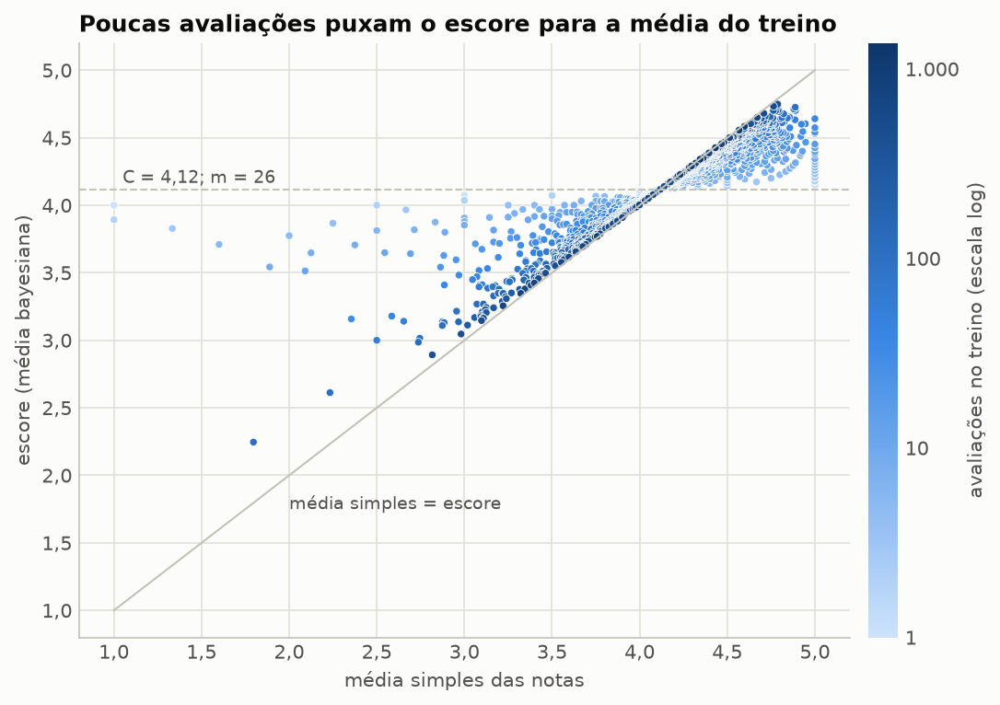

**Escore bayesiano:** com `m` = 26, os 194 locais com menos de 10 avaliações no treino têm média simples de 1 a 5, mas escore só de 3,54 a 4,34, perto de `C` = 4,12. Locais com centenas de avaliações ficam sobre a diagonal.

**Exemplos:**

- **Usuário A** (5 avaliações, Cheyenne): perfil com bar no local, restaurante, café da manhã e hamburgueria. A lista traz locais populares e bem avaliados da cidade, como Texas Roadhouse e Chick-fil-A, e termina com um local novo, o Rodolfo's Mexican Grill, pela cota.
- **Usuário B** (23 avaliações, Evanston): perfil com restaurante, fast food, pagamento por aproximação e restaurante mexicano. A lista começa com o Jalisco Mexican Grill, "porque você gostou de Don Pedro's Family Mexican Restaurant", e tem quatro locais novos que entraram por mérito, sem a cota. Isso sugere que, em uma cidade pequena, a popularidade mediana atribuída aos locais novos compete com a dos conhecidos, ao contrário do que acontece em Cheyenne.

**Congelamento:** todas as decisões estão em `modelos/configuracao.json`:

| Tema | Decisão |
|---|---|
| Vetor | Categorias + atributos declaráveis, TF-IDF por bloco, `min_df = 2` |
| Escore | `m` no percentil 25 |
| Local | Distância, τ = 200 km |
| Perfil | Centro na média do usuário (cenário 1); centro 3 (cenário 3) |
| Cenário 1 | 0,1 / 0,2 / 0,5 / 0,2 |
| Cenário 2 | 0,05 / 0,19 / 0,475 / 0,285; categorias com peso |
| Cenário 3 | 0,5 / 0,5 (conteúdo / local); cota de 1 local novo |
| Previsão de nota | Escore + viés, `reg = 10` |

O modelo foi reajustado em `treino_total` (343.697 avaliações, 140.895 perfis, `C` = 4,132, `m` = 36,8) e em `treino_total_c3` (318.092 avaliações, sem os locais simulados do teste), e os dois foram gravados em `modelos/`. Recarregados, eles reproduzem as mesmas listas. Como guardam o treino, com identificadores de usuários, os arquivos `.joblib` ficam fora do repositório e são regenerados pelo notebook.

**Ponto de decisão:** a usuária confirmou a configuração e a técnica antes do teste, ciente da comparação com as referências.

## 5. Avaliação final

O notebook `04_avaliacao.ipynb` só carrega a configuração e os modelos congelados e mede tudo no **teste** (85.925 avaliações, de 31/03/2020 a 04/09/2021), usado uma única vez. As funções de avaliação estão em `src/avaliacao.py`. Antes da execução no teste, elas foram ensaiadas na validação, numa cópia temporária do notebook, e reproduziram os números do notebook do modelo. O próprio notebook 04 roda as mesmas funções na validação para a comparação validação × teste. Intervalos de 95% por bootstrap de usuários.

### 5.1 Cenário 1: usuário antigo

5.663 usuários antigos e 1.525 candidatos; a AUC de gosto vale para 1.674 usuários.

| Ordenação | Conversão@10 | AUC de gosto | Conversão − modelo (IC 95%) | Gosto − modelo (IC 95%) | Cobertura do catálogo |
|---|---|---|---|---|---|
| **Modelo** | **0,0520 (0,0498 a 0,0542)** | **0,5542 (0,5372 a 0,5708)** | — | — | 46,1% |
| Aleatório | 0,0020 | 0,4967 | −0,0500 | −0,0575 | 100% |
| Popularidade | 0,0144 | 0,4584 | −0,0376 | −0,0957 | 1,4% |
| Só escore | 0,0028 | 0,6943 | −0,0492 | +0,1401 | 1,0% |
| Só local | 0,0298 | 0,4876 | −0,0222 | −0,0665 | 95,7% |
| Popularidade + local | 0,0532 | 0,4516 | empate | −0,1026 (−0,1164 a −0,0883) | 33,2% |
| Sem conteúdo | 0,0525 | 0,5488 | empate | empate | 41,6% |
| Vizinhos por item | 0,0599 | 0,4477 | +0,0079 (0,0058 a 0,0101) | −0,1065 | 60,2% |
| Vizinhos por item, combinado | 0,0651 | 0,4887 | +0,0131 (0,0114 a 0,0148) | −0,0654 | 52,9% |
| PageRank personalizado | 0,0637 | 0,4493 | +0,0117 (0,0100 a 0,0134) | −0,1048 | 48,5% |

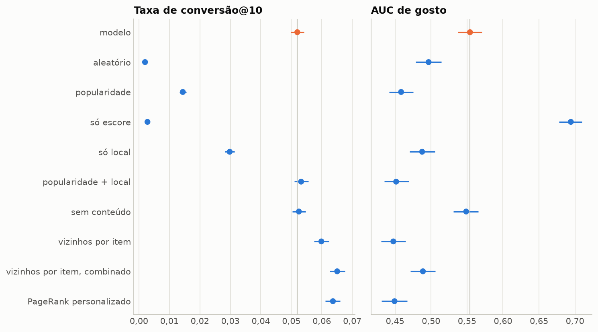

O modelo empata na conversão com a lista óbvia (popularidade + local) e com a versão sem conteúdo. Ele é o único, entre as ordenações que convertem, com AUC de gosto acima do acaso. As técnicas colaborativas convertem até 25% mais, mas ficam abaixo do acaso no gosto. Na sensibilidade com usuários com 1 ou mais avaliações no treino (9.949), o modelo converte 0,0438, em empate com popularidade + local e com sem conteúdo, e fica 0,0958 acima de popularidade + local na AUC de gosto.

Acompanhamento do modelo: consumo@10 de 0,0582, AUC de consumo de 0,9114, novidade de 9,14, serendipidade de 0,0157 e diversidade de 0,6912.

### 5.2 Cenário 2: usuário novo

6.783 usuários novos com 2 ou mais avaliações no teste (1.255 com AUC de gosto).

| Método | Conversão@10 | AUC de gosto | Cobertura do catálogo |
|---|---|---|---|
| 1. Popularidade | 0,0097 | 0,4916 | 0,7% |
| 2. Escore | 0,0020 | 0,6739 | 0,7% |
| 3. Escore + popularidade | 0,0097 | 0,5591 | 0,7% |
| 4. Local + escore + popularidade | 0,0450 | 0,5623 | 27,0% |
| **5. Modelo: + categorias com peso** | **0,0452 (0,0435 a 0,0471)** | **0,5598 (0,5376 a 0,5806)** | **30,6%** |
| 5. + categorias como filtro | 0,0232 | 0,4983 | 81,6% |
| 6. + local de exemplo, mesmo peso | 0,0453 | 0,5564 | 30,4% |

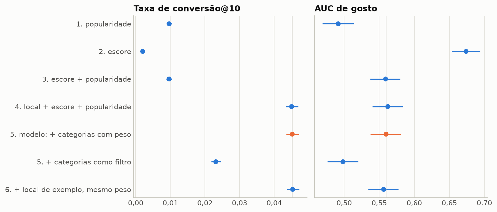

Como na validação, a categoria declarada com peso empata com o método 4 e amplia o catálogo, e como filtro derruba a conversão à metade. A cobertura de usuários é de 100% em todos os métodos.

### 5.3 Cenário 3: local novo para usuário antigo

| Origem | Ordenação | AUC de consumo | Conversão@10 | AUC de consumo − só local (IC 95%) |
|---|---|---|---|---|
| Naturais (100 locais, 729 usuários) | Só local | 0,9173 | 0,0881 | — |
| | **Modelo (α = 0,5)** | **0,9209** | **0,0867** | **+0,0036 (−0,0008 a 0,0076), empate** |
| | Só conteúdo | 0,5402 | 0,0155 | −0,3772 |
| | Aleatório | 0,4779 | 0,0111 | −0,4394 |
| Simulados (100 locais, 1.107 usuários) | Só local | 0,8770 | 0,0771 | — |
| | **Modelo** | **0,8814** | **0,0793** | **+0,0044 (0,0002 a 0,0084)** |

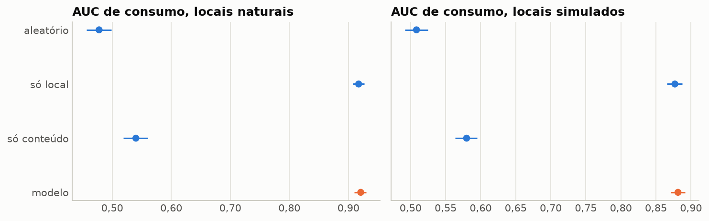

- **O ganho do conteúdo nos locais novos reais não se confirmou:** na validação, ele somava 0,0119 de AUC de consumo; no teste, empata com o só local, também na conversão. Nos simulados, que têm metadados mais ricos, ele continua ajudando pouco, fora do empate.
- **Saída A (local → usuários):** AUC por local de 0,8938 nos naturais, em empate com o só local (+0,0056, IC 95% de −0,0016 a 0,0127, 88 locais); 0,8954 nos simulados, +0,0112 (IC 95% de 0,0052 a 0,0167).
- **Saída B:** o local novo natural convertido fica em 72º, em mediana, na lista do cenário 1; só 3,1% chegam ao top-10, e 3,7% das listas têm algum local novo.
- **Cota:** as listas que acertam um local novo natural passam de 21 para 126, e os locais novos listados, de 42 para 95 de 100, com −0,0014 de conversão@10 (de 0,0496 para 0,0482). Nos simulados, de 15 para 151 listas, com −0,0009.
- **Cobertura do espaço de itens novos:** conteúdo 100%; vizinhos por item e PageRank 0%.

### 5.4 Curvas ROC

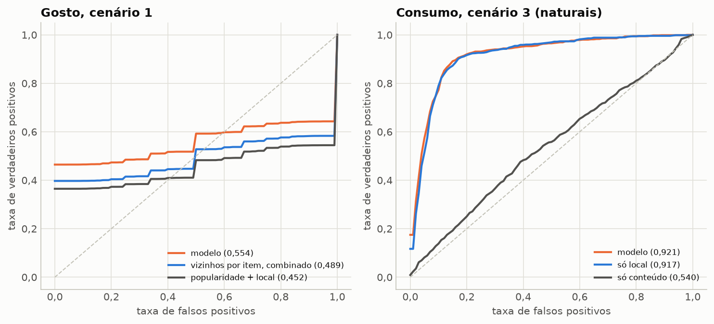

A curva de gosto é feita de degraus porque a maioria dos usuários tem um ou dois locais bons e um ou dois ruins no teste. Ela começa na fração de usuários em que todos os bons ficam acima dos ruins: cerca de 46% no modelo, 40% no combinado e 36% em popularidade + local. Na curva de consumo dos locais novos, o modelo e o só local quase se sobrepõem.

### 5.5 Previsão de nota

| Previsão | MAE | MSE | RMSE |
|---|---|---|---|
| Média global | 0,8982 | 1,2854 | 1,1337 |
| Escore | 0,8524 | 1,1755 | 1,0842 |
| **Escore + viés** | **0,7751 (0,7623 a 0,7880)** | **1,0502** | **1,0248 (1,0069 a 1,0418)** |

Em 21.121 avaliações de 6.335 usuários antigos, a ordem é a da validação, com erros um pouco maiores. A correlação de rankings do modelo é de 0,0721 (Spearman) e 0,0619 (tau-b de Kendall), a maior entre as ordenações comparadas.

### 5.6 Exemplos e estabilidade temporal

Nos dois usuários sorteados, nenhum dos 10 locais recomendados foi avaliado no teste, embora as listas sejam plausíveis: um deles avaliou depois, com nota 5, um restaurante que aparece na lista do outro. É a limitação da conversão offline.

| Período do teste | Avaliações | Usuários | Conversão@10 do modelo | Popularidade + local |
|---|---|---|---|---|
| Primeiro ano (até 31/03/2021) | 74.081 | 5.219 | 0,0504 | 0,0521 |
| Depois | 11.844 | 1.326 | 0,0235 | 0,0224 |

A queda atinge as duas ordenações e acompanha a coleta rarefeita no fim da base.

### 5.7 Validação × teste

| Cenário | Métrica | Validação | Teste |
|---|---|---|---|
| 1 | Conversão@10 | 0,0739 | 0,0520 |
| 1 | AUC de gosto | 0,5850 | 0,5542 |
| 2 | Conversão@10 | 0,0484 | 0,0452 |
| 2 | AUC de gosto | 0,5541 | 0,5598 |
| 3, naturais | AUC de consumo | 0,9314 | 0,9209 |
| 3, naturais | Conversão@10 | 0,0939 | 0,0867 |
| 3, simulados | AUC de consumo | 0,8858 | 0,8814 |
| Previsão de nota | RMSE | 0,9871 | 1,0248 |

### 5.8 Conclusões e limitações

**Conclusões:**

1. O sistema atende os três cenários com uma técnica, com 100% de cobertura de usuários e de locais novos.
2. Entre as ordenações que convertem, o modelo é o único com AUC de gosto acima do acaso nos cenários 1 e 2.
3. O conteúdo pesa pouco nas métricas principais: empata nos cenários 1 e 2 e só amplia o catálogo; no cenário 3, ajudou na validação e nos simulados, mas empatou com o só local nos locais novos reais do teste.
4. Localização e popularidade respondem pela conversão; o escore, pelo gosto.

**Limitações:**

- A conversão offline é uma aproximação: um local não avaliado pode só ser desconhecido.
- A medida favorece popularidade e proximidade.
- O sinal de gosto vem da qualidade do local, com pouca personalização (correlação de rankings de 0,07).
- A AUC de gosto usa só os usuários com notas boas e ruins no período.
- Os metadados são de 2021, e os locais simulados são mais fáceis que os novos reais.
- O teste começa na pandemia, e a coleta rareia no fim da base.
- Vizinhos por item convertem até 25% mais para usuários antigos; a técnica foi mantida porque o enunciado pede uma técnica, só o conteúdo atende os três cenários e só ele acerta o gosto.
- O ganho do conteúdo nos locais novos reais não se confirmou no teste.

## 6. Interface

Código em `app.py` (Streamlit), funções sem Streamlit em `src/interface.py`, testes em `testes/test_interface.py` e telas em `figuras/50_` a `53_`, geradas por `scripts/capturar_telas.py` com casos fixos. Para rodar: `streamlit run app.py`, depois dos notebooks 01 a 03.

**Modelos:** a interface carrega os modelos congelados da seção 4.9 (`recomendador.joblib`, ajustado em `treino_total`, e `recomendador_c3.joblib`, em `treino_total_c3`), com cache; a primeira carga leva de 5 a 30 segundos, e cada interação, menos de 1 segundo. Os usuários aparecem só como "Usuário #N", numerados pela ordem alfabética do identificador, de 1 a 140.895.

**Barra lateral:** descrição do sistema e dos quatro componentes da pontuação, e o tamanho da lista, de 5 a 20, que vale para todas as abas.

**Abas:**

| Aba | O que mostra |
|---|---|
| Demonstração | Um usuário sorteado (10 ou mais avaliações) ou escolhido: indicadores, o gráfico do que pesa no gosto (os maiores pesos positivos e negativos do perfil), as notas que deu, o mapa com os locais avaliados e o top N, e as recomendações em prateleiras de cartões: "Top para você", "Porque você gostou de X" (até duas), "Novidades para você" e "Bem avaliados perto de você" |
| Usuário antigo | Cenário 1: perfil em texto, cidades, histórico e o top N com a marca dos locais novos, a pontuação, a nota prevista, as barras dos quatro componentes e a explicação |
| Usuário novo | Cenário 2: formulário com cidade, preço, categorias (como preferência ou filtro), atributos e local de exemplo, todos opcionais; mostra o que foi usado e os avisos da regra de não esvaziar |
| Local novo | Cenário 3: um dos 200 locais novos do teste (100 reais e 100 simulados) ou um cadastro com nome, cidade, categorias, atributos e coordenada opcional; (A) os N usuários mais indicados, com conteúdo, localização e o porquê; (B) a posição do local na lista de um usuário e a decisão de recomendar |

**Todas as prateleiras vêm da pontuação do modelo:** o "Top para você" é a lista do cenário 1, com a cota; "Porque você gostou de X" agrupa os 40 primeiros da lista pelo local que a explicação aponta, quando são 3 ou mais; "Novidades para você" ordena os locais sem avaliações pela mesma pontuação; "Bem avaliados perto de você" reordena pelo escore os 40 primeiros com localização acima da mediana. "Compatível" é a pontuação × 100, e não uma probabilidade; a nota prevista é a da seção 4.8.

**Mensagens:** usuário inexistente; formulário vazio (a lista segue qualidade e popularidade); cidade com poucos locais e preço ou categorias sem locais suficientes (regra de não esvaziar); cidade sem locais na base e sem coordenada (o componente de localização fica zero); cadastro sem categorias nem atributos (conteúdo neutro); cadastro vazio (todos os usuários empatam).

**Testes:** os três cenários e as mensagens foram exercitados no painel do navegador e por script, com o `AppTest` do Streamlit, sem erros. Casos: o Usuário #70.927 (9 avaliações, Greybull) recebe locais de Greybull e arredores, com dois locais novos; o usuário novo com Moran, pizzaria e preço $$$$ como filtro recebe a lista com os avisos de preço e de cidade pequena; o cadastro na cidade "Gotham", fora da base, recebe o aviso de localização zero. O teste de `prateleiras` pegou um defeito: o top saía da lista ampliada de 40, na qual a cota vale para as 40 posições, e por isso diferia da lista do cenário 1; ele passou a vir da chamada com N.

**Limitações:**

- A ordem segue sobretudo a localização e a popularidade, como mostram as barras: no usuário novo de Cheyenne com cafeteria e Wi-Fi, a primeira cafeteria fica em 10º, porque o conteúdo pesa 0,05 no cenário 2.
- As prateleiras repetem locais entre si, como num catálogo; o "Top para você" é a única que segue exatamente a lista avaliada na seção 5.
- A decisão de recomendar do cenário 3 considera só o mérito; a cota de 1 local novo pode levar o local à lista mesmo fora do top N.

## 7. Apresentação

Roteiro em `apresentacao/roteiro_slides.md` e base dos slides em `apresentacao/T1_Sistema_Recomendacao.pptx`, gerada por `scripts/gerar_ppt.py`. A base segue o modelo simples da usuária no Canva, onde os slides finais serão montados.

**Estrutura, para cerca de 15 minutos:**

| Item do enunciado | Slides |
|---|---|
| a. Capa | 1 |
| b. O sistema | 2 |
| c. A base | 3 a 5 |
| d. Teoria do modelo | 6 a 8 |
| e. Tratamento dos dados | 9 |
| f. Treino e teste | 10 |
| g. Estimação | 11 e 12 |
| h. Performance | 13 e 14 |
| i. Interface | 15 (demonstração) e 16 (os três cenários) |
| Conclusões | 17 |
| Apêndice | sazonalidade, escolhas dos cenários 2 e 3, curvas ROC e previsão de nota, telas inteiras |

**Demonstração:** roteiro ao vivo de cerca de 2min30, com o app aberto antes da aula: a aba Demonstração com o Usuário #12.369, o usuário novo de Cheyenne com cafeteria e um local novo real. As telas do slide 16 e do apêndice servem de reserva. Usar ou não a demonstração ao vivo ainda será decidido.

**Conferências:** o validador do arquivo passou; cada slide foi renderizado pelo PowerPoint e revisado; o texto não cita nenhuma métrica fora das vistas em aula; todos os slides têm notas do orador.

**Limitações:** as fontes do modelo (Montserrat e Inter) não estão instaladas, e a base usa Century Gothic e Arial; os integrantes ainda não constam da capa.

## 8. Entrega

*A preencher na Fase 7.*

## Histórico de alterações

- **2026-11-03:** relatório criado na Fase 0.
- **2026-11-03:** na seção 2.1, saíram as contagens de `rating`, `user_id`, texto, fotos e respostas do arquivo inteiro, porque o notebook passou a carregar só as avaliações do recorte. Os valores do recorte estão na seção 2.2.
- **2026-11-04:** a seção 4.3 registra a escolha conjunta de local e pesos, que substituiu a escolha do local com pesos fixos prevista no plano.
- **2026-11-04:** na seção 4.4, os pesos do usuário novo e do local novo deixaram de ser provisórios (seções 4.5 e 4.6), e a lista do usuário antigo ganhou a cota de 1 local novo.
- **2026-11-05:** a seção 6 registra a interface com quatro abas; a aba Demonstração foi pedida pela usuária durante a Fase 5.
- **2026-11-05:** a seção 7 registra a base dos slides, gerada a partir do modelo da usuária no Canva.
